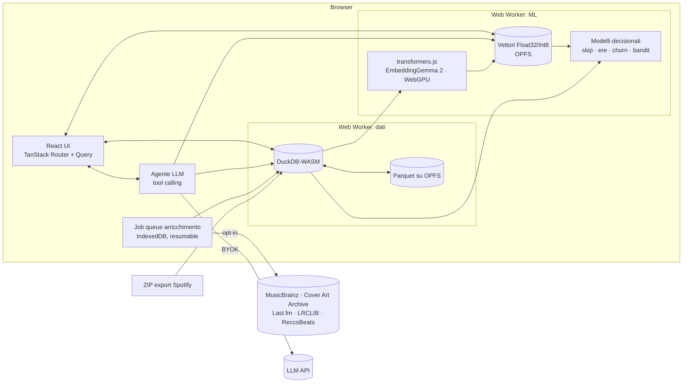

# Spotify Stats — Piano di evoluzione 2026

> Documento di progetto: analisi dello stato attuale, architettura target, roadmap tecnica (dati, embeddings, LLM, modelli decisionali) e redesign completo UI/UX.
> Data: 4 novembre 2026 · Repo: `Spotify-Stats/`

---

## Indice

0. [Sommario esecutivo](#0-sommario-esecutivo)
1. [Stato attuale](#1-stato-attuale)
2. [Principi guida](#2-principi-guida)
3. [Architettura target](#3-architettura-target)
4. [Fase 0 — Pulizia e sicurezza](#4-fase-0--pulizia-e-sicurezza)
5. [Fase 1 — Motore dati DuckDB-WASM](#5-fase-1--motore-dati-duckdb-wasm)
6. [Fase 2 — Arricchimento metadati](#6-fase-2--arricchimento-metadati)
7. [Fase 3 — Embeddings dei brani](#7-fase-3--embeddings-dei-brani)
8. [Fase 4 — Mood v2](#8-fase-4--mood-v2-misurato-non-indovinato)
9. [Fase 5 — Modelli decisionali e comportamentali](#9-fase-5--modelli-decisionali-e-comportamentali)
10. [Fase 6 — Agente "Chiedi ai tuoi dati"](#10-fase-6--agente-chiedi-ai-tuoi-dati)
11. [Fase 7 — Redesign UI/UX](#11-fase-7--redesign-uiux)
12. [Refactor codebase e qualità](#12-refactor-codebase-e-qualità)
13. [Roadmap e stime](#13-roadmap-e-stime)
14. [Rischi e mitigazioni](#14-rischi-e-mitigazioni)
15. [Metriche di successo](#15-metriche-di-successo)
16. [Fonti: paper, repo, documentazione](#16-fonti-paper-repo-documentazione)

---

## Stato di implementazione (4 novembre 2026, branch `feat/v2-evolution`)

| Fase | Stato | Note |
|---|---|---|
| 0 — Pulizia e sicurezza | ✅ | Rimossi proxy CORS, AcousticBrainz, client secret Spotify, Pyodide, Plotly. `.gitignore` per gli export. Registro connessioni in Impostazioni. |
| 1 — DuckDB-WASM | ✅ | Import 77k ascolti in ~1,6 s; riapertura ~1,9 s da IndexedDB (Arrow IPC). Sessioni, `prior_plays`, `plays_seq` calcolati in SQL. Definizione "ascolto" = ≥ 30 s. |
| 2 — Arricchimento | ✅ | Copertine (oEmbed, una per album, con retry su rate limit), audio features ReccoBeats, testi LRCLIB, tag Last.fm (chiave utente). Job resumable con pausa. Nessuna MusicBrainz: non serve. |
| 3 — Embeddings | ✅ | Embedding via OpenRouter (`google/gemini-embedding-2`, 256 dim, chiave utente; ~$0,05 / 1.000 brani). UMAP + k-means nel Web Worker; galassia canvas con zoom/lazo; ricerca semantica; brani/artisti simili. Il modello locale (transformers.js) è stato rimosso su richiesta. Audio embeddings (MuQ-MuLan/CLAP) **non** implementati: richiedono audio. |
| 4 — Mood v2 | ✅ (da provare con chiave) | Anchor stratificati dai brani ReccoBeats, JSON Schema rigido, 2 campionamenti → confidenza, hold-out di 12 brani per MAE/Pearson. |
| 5 — Modelli | ✅ | Skip: regressione logistica, split temporale, AUC 0,75 su dati reali, importanza per permutazione. Ere: segmentazione binaria (Hellinger). Kaplan–Meier artisti. Bandit Thompson per la riscoperta. Tipologie di sessione. |
| 6 — Agente + racconto | ✅ (agente da provare con chiave) | Tool `run_sql` (guard read-only testato), `semantic_search`, `make_chart`, `show_tracks`; tracce ispezionabili. Story mode annuale + immagine 9:16; didascalie AI opzionali. |
| 7 — Redesign UI/UX | ✅ | Design system (token OKLCH, Instrument Serif + Geist), 8 sezioni, ⌘K, filtro periodo globale, pagine entità, colore dinamico dalle copertine, mobile bottom nav, PWA (manifest + service worker). |
| 7b — Umore nel tempo | ✅ | Calendario giornaliero per stato d’animo, andamento giorno/settimana/mese (rispetto al neutro o alla media personale), momenti della settimana. |
| 2b — Pacchetto “Dati dell’account” | ✅ | ZIP separato supportato (anche insieme all’esteso): nome, libreria, playlist, ricerche, inferenze, Wrapped → pagina Profilo e UI personalizzata; storico di 1 anno mappato a URI via libreria/playlist; avviso se manca il secondo pacchetto. Cache catalogo (copertine, audio features) condivisa tra export. |
| 10.3 — Confronta | ✅ | Solo aggregati salvati; compatibilità artisti + somiglianza semantica. |
| 12 — Test/CI | ✅ | Vitest: unit + 8 test SQL su export reale (`SPOTIFY_TEST_ZIP`, saltati in CI). GitHub Actions: lint, typecheck, test, build. |

Scostamenti dal piano: TanStack Router/Query → router hash minimale + hook `useSql` (meno dipendenze); Observable Plot + canvas 2D al posto di deck.gl (sufficiente fino a ~20k punti); persistenza in IndexedDB invece di Parquet/OPFS (più robusta tra versioni del motore).

---

## 0. Sommario esecutivo

L'app oggi è una dashboard statistica solida (≈9.500 righe, React 19 + Pyodide/pandas + Plotly) con una sezione "Mood" basata su fonti che **non funzionano più** (Spotify `audio-features` → 403 dal 27/11/2024; AcousticBrainz fermo dal 2022) o che **indovinano** (LLM che stima la valence dal solo titolo). Inoltre usa proxy CORS di terze parti, in contraddizione con la promessa "i tuoi dati non lasciano il computer".

La proposta trasforma il progetto da *"grafici sul mio storico"* a **"un'intelligenza personale sui miei ascolti"**, local-first:

| Pilastro | Da | A |
|---|---|---|
| Dati | Pyodide + pandas (lento, pesante) | **DuckDB-WASM** + Parquet su OPFS, in Web Worker |
| Rappresentazione brani | Nessuna (solo nome) | **Embeddings** testuali locali (EmbeddingGemma 2 via transformers.js/WebGPU), opz. audio (MuQ-MuLan / CLAP) |
| Mood | LLM zero-shot su titolo | Valence/arousal da **testi + tag + few-shot anchors**, con confidenza calibrata |
| Analisi | Statistiche descrittive | **Modelli decisionali**: predizione skip, ere musicali, churn artisti, bandit di riscoperta |
| Interazione | 16 tab statici | **Agente** con tool (SQL + ricerca semantica + grafici) e **story mode** |
| UI/UX | Card a gradiente arcobaleno, emoji, nessuna cover | Design system editoriale, cover art, colore dinamico, galassia WebGL, ⌘K, mobile/PWA |

Stima complessiva: **~5–6 settimane** part-time per arrivare a v2 completa; la Fase 0 (≈3 ore) va fatta subito.

---

## 1. Stato attuale

### 1.1 Stack

- React 19, TypeScript 5.9, Vite 7, Tailwind 4
- Pyodide 0.29 + pandas (`public/data_crunching.py`, 1.364 righe) per tutto il calcolo
- Plotly.js (+ `react-plotly.js`) per i grafici
- `openai` SDK puntato su OpenRouter (`google/gemini-2.0-flash-001`) per il mood
- Storage: `localStorage` (cache risultati) + IndexedDB (file ZIP, risultati mood)

### 1.2 Inventario file

| File | Righe | Ruolo | Note |
|---|---:|---|---|
| `src/components/MoodContent.tsx` | 2.012 | UI mood + orchestrazione provider | Monolite: va spezzato |
| `public/data_crunching.py` | 1.364 | Tutte le aggregazioni pandas | Portabile in SQL quasi 1:1 |
| `src/utils/pyodide.ts` | 880 | Bootstrap Pyodide, bridge JS↔Py | Sparisce con DuckDB |
| `src/utils/openrouter.ts` | 542 | Batch LLM per mood | Prompt duplica logica di `get_mood()` |
| `src/utils/acousticbrainz.ts` | 444 | MusicBrainz + AcousticBrainz via proxy CORS | **Privacy leak**, servizio morto |
| `src/utils/spotifyApi.ts` | 425 | Client credentials + audio-features | **Endpoint 403**, secret nel browser |
| `src/components/DataTable.tsx` | 427 | Tabelle | Non virtualizzata |
| `src/utils/audioFeaturesProviders.ts` | 290 | MusicBrainz/AcousticBrainz/Last.fm | Last.fm utile, resto da rifare |
| `src/components/StatsContent.tsx`, `ChartModal.tsx`, `Plot.tsx`, `MultiLinePlot.tsx` | ~1.200 | Grafici Plotly | |
| `src/components/Sidebar.tsx` | 106 | 6 tab principali + 10 "avanzate" | IA piatta |

### 1.3 Problemi critici (da risolvere prima di tutto)

1. **Privacy leak** — `src/utils/acousticbrainz.ts:51` e `:76` instradano richieste attraverso `api.allorigins.win` e `corsproxy.io`. Titoli/artisti dell'utente passano da server terzi sconosciuti.
2. **Secret nel browser** — `spotifyApi.ts` usa il flusso *client credentials* con `clientSecret` salvato in `localStorage` o in `VITE_SPOTIFY_CLIENT_SECRET` (finisce nel bundle).
3. **Endpoint morti** — Spotify `audio-features`, `audio-analysis`, `recommendations`, `related-artists` e preview URL non disponibili per app nuove dal 27/11/2024. AcousticBrainz non raccoglie dati dal 2022.
4. **Mood inaffidabile** — l'LLM stima valence/energy dal solo `"titolo" di artista`. La letteratura 2026 mostra che la valence zero-shot da LLM ha R² ≈ 0.11 (praticamente rumore); l'arousal va meglio.
5. **Prestazioni** — Pyodide + pandas = decine di MB e diversi secondi di cold start ad ogni sessione.
6. **Manutenibilità** — monoliti (`MoodContent.tsx`), nessun test, nessuna separazione dominio/UI, `console.log` ovunque.
7. **Dati di terzi** — gli export di altre persone usati per i test non devono mai finire nel repo; vanno usati solo come fixture anonimizzate e con consenso.

---

## 2. Principi guida

1. **Local-first per davvero.** Tutto ciò che può girare nel browser gira nel browser. Ogni chiamata esterna è *opt-in*, visibile in un pannello "Connessioni" e documentata.
2. **Misurare, non indovinare.** Nessun numero inventato da un LLM senza segnale reale (testi, tag, audio) e senza una stima di confidenza.
3. **Deterministico dove possibile, LLM dove serve.** Le regole (quadranti mood, sessioni, aggregati) restano codice; l'LLM produce segnali grezzi, narrazione e ragionamento su tool.
4. **Progressive enhancement.** Statistiche base in <1 s; arricchimenti (metadati, embeddings, mood) in background, ripristinabili, cache per brano.
5. **BYOK (Bring Your Own Key).** Le funzioni LLM usano la chiave dell'utente; l'app resta utilizzabile al 100% senza.
6. **Spiegabilità.** Ogni insight "intelligente" mostra *perché* (feature importanti, brani esempio, query SQL usata).

---

## 3. Architettura target



### Modello dati (DuckDB)

```sql
-- Eventi grezzi (uno per riga dell'export)
CREATE TABLE plays (
  ts                TIMESTAMP,      -- UTC
  ts_local          TIMESTAMP,      -- convertito con fuso stimato da conn_country
  ms_played         INTEGER,
  track_uri         VARCHAR,
  track_name        VARCHAR,
  artist_name       VARCHAR,
  album_name        VARCHAR,
  episode_uri       VARCHAR,        -- podcast (separati)
  platform          VARCHAR,
  conn_country      VARCHAR,
  reason_start      VARCHAR,
  reason_end        VARCHAR,
  shuffle           BOOLEAN,
  skipped           BOOLEAN,
  offline           BOOLEAN,
  incognito_mode    BOOLEAN,
  session_id        INTEGER         -- calcolato: gap > 30 min = nuova sessione
);

-- Dimensione brano (una riga per track_uri)
CREATE TABLE tracks (
  track_uri    VARCHAR PRIMARY KEY,
  track_name   VARCHAR,
  artist_name  VARCHAR,
  album_name   VARCHAR,
  duration_ms  INTEGER,             -- stimata: max(ms_played) dei play "trackdone"
  isrc         VARCHAR,
  mbid         VARCHAR,
  cover_url    VARCHAR,
  tags         VARCHAR[],           -- Last.fm top tags
  lyrics       VARCHAR,             -- LRCLIB (plain)
  language     VARCHAR,
  valence      DOUBLE,
  arousal      DOUBLE,
  mood_conf    DOUBLE,
  mood_source  VARCHAR,             -- 'reccobeats' | 'llm_lyrics' | 'clap' | ...
  cluster_id   INTEGER,
  umap_x       DOUBLE,
  umap_y       DOUBLE
);

-- Cache arricchimento (resumable)
CREATE TABLE enrichment_jobs (
  track_uri VARCHAR, step VARCHAR, status VARCHAR, attempts INTEGER, updated_at TIMESTAMP,
  PRIMARY KEY (track_uri, step)
);
```

---

## 4. Fase 0 — Pulizia e sicurezza

**Durata: ~3 ore. Da fare subito.**

1. Eliminare l'uso di `allorigins.win` e `corsproxy.io` (`src/utils/acousticbrainz.ts`).
2. Rimuovere AcousticBrainz come provider (servizio fermo); tenere solo il lookup MusicBrainz diretto (verificare header CORS; in caso negativo spostarlo in un endpoint serverless *proprio*, documentato).
3. Rimuovere il flusso *client credentials* da `spotifyApi.ts`. Se servono dati Spotify (cover, ISRC), usare **Authorization Code + PKCE** (nessun secret) o l'oEmbed pubblico. Verificare i limiti attuali della *development mode* di Spotify prima di investirci.
4. Rimuovere `VITE_SPOTIFY_CLIENT_SECRET` da ogni `.env` e ruotare il secret se è mai stato committato o buildato.
5. Integrare **ReccoBeats** (`https://api.reccobeats.com/v1`) come rimpiazzo "drop-in" di audio-features per ID Spotify — opt-in, con misura della copertura sul proprio storico.
6. `.gitignore`: `*.zip`, `my_spotify_data*`, `Streaming_History*`, cartelle personali.
7. Aggiornare il README con l'elenco onesto delle connessioni esterne.

**Definition of done:** nessuna richiesta di rete verso host non elencati nel README (verificabile con DevTools → Network, filtro per dominio).

---

## 5. Fase 1 — Motore dati DuckDB-WASM

**Durata: 2–3 giorni.**

### Perché
- Cold start: da diversi secondi (Pyodide + pandas) a pochi centinaia di ms.
- SQL colonnare vettoriale: aggregazioni su 100k+ righe in millisecondi.
- Persistenza in **Parquet su OPFS**: riapertura istantanea senza ri-parsare il JSON.
- È la base per l'agente (text-to-SQL) della Fase 6.

### Passi
1. `@duckdb/duckdb-wasm` in un Web Worker dedicato; API tipizzata via `comlink`.
2. Import: unzip con `fflate` → `read_json_auto` su ogni `Streaming_History_Audio_*.json` → `INSERT INTO plays`.
3. Post-processing in SQL: `ts_local`, `skipped` normalizzato, `session_id` con window function:
   ```sql
   SELECT *, SUM(CASE WHEN ts - LAG(ts) OVER (ORDER BY ts) > INTERVAL 30 MINUTE THEN 1 ELSE 0 END)
            OVER (ORDER BY ts) AS session_id
   FROM plays;
   ```
4. Porting delle funzioni di `data_crunching.py` in viste/query SQL (tabella sotto).
5. `COPY plays TO 'opfs://plays.parquet' (FORMAT PARQUET)`; al riavvio `CREATE VIEW plays AS SELECT * FROM 'opfs://plays.parquet'`.
6. Test di parità: per ogni funzione, confronto output pandas vs SQL su 3 export reali (fixture anonimizzate).
7. Rimuovere Pyodide (o caricarlo lazy solo se una feature ML lo richiede, vedi Fase 5).

### Mappa di porting

| Funzione Python | Query/vista SQL |
|---|---|
| `get_single_values` | `v_basic_stats` (un'unica `SELECT` con aggregati e `FILTER`) |
| `get_most_played_artists_tracks_albums_total` | `GROUP BY artist/track/album ORDER BY plays DESC` + `SUM(ms_played)` |
| `get_most_played_artist_track_album_monthly` | `date_trunc('month', ts_local)` + `QUALIFY ROW_NUMBER() ... = 1` |
| `get_hours_played_per_hour_of_the_day` | `hour(ts_local)` |
| `get_avg_hours_played_per_year_month_weekday` | `dayofweek`, `month`, `year` |
| `get_cumulative_percent_play_count_track_artists` | `SUM(...) OVER (ORDER BY plays DESC)` |
| `get_yeary_track_artist_play_count` (+ `mark_new_tracks`) | `MIN(ts) OVER (PARTITION BY track_uri)` = prima scoperta |
| `get_skipped_statistics` | aggregati su `skipped`, `reason_end`, bucket di `ms_played` |
| `get_user_agent_statistics` / `parse_user_agent` | `regexp_extract` su `platform` |
| `get_plays_per_county_toal` | `GROUP BY conn_country` |
| `get_mood_statistics` | `JOIN tracks USING (track_uri)` su `valence/arousal` |
| `classify_mood` | resta in TS (`get_mood`) o macro SQL `CREATE MACRO mood(v, a) AS CASE ...` |

---

## 6. Fase 2 — Arricchimento metadati

**Durata: 1–2 giorni.** Tutto opt-in, cache per `track_uri`, job queue ripristinabile.

| Dato | Fonte | Note |
|---|---|---|
| MBID, ISRC | MusicBrainz WS2 | Rate limit 1 req/s, User-Agent con contatto *del progetto* (non email personale hardcodata) |
| Cover art | Cover Art Archive (da MBID); fallback Spotify oEmbed | Necessaria per il redesign |
| Tag/generi | Last.fm `track.getTopTags` / `artist.getTopTags` | Chiave Last.fm dell'utente |
| Testi | LRCLIB (`/api/get?artist_name=&track_name=`) | Gratuito, senza chiave |
| Audio features | ReccoBeats (per ID Spotify) | Copertura parziale: misurarla |
| Lingua testo | `franc` / `cld3-asm` locale | Serve per pesare i testi nel mood |

### Job queue
- Tabella `enrichment_jobs` (step: `mb`, `cover`, `tags`, `lyrics`, `reccobeats`, `embed`, `mood`).
- Priorità: brani ordinati per tempo di ascolto totale (i top 500 coprono tipicamente la maggior parte dell'ascolto → valore immediato).
- Concorrenza per host configurabile; backoff esponenziale su 429/5xx; `AbortController` unico per job.
- UI: drawer "Attività" con avanzamento per step, stima tempo residuo, pausa/riprendi.

---

## 7. Fase 3 — Embeddings dei brani

**Durata: ~3 giorni (testo) + 2–4 giorni opzionali (audio).**

### 7.1 Embedding testuale (locale, gratuito)

- Modello: **EmbeddingGemma 2** (`onnx-community/embeddinggemma-2-ONNX`, `dtype: "q4"`, `device: "webgpu"` con fallback `wasm`) via **transformers.js v4**. Alternativa leggera: EmbeddingGemma (300M) o `mxbai-embed-xsmall-v1`.
- Dimensione: Matryoshka a **256** dimensioni (buon compromesso qualità/memoria); normalizzati L2.
- Documento per brano:
  ```text
  title: {track_name}
  artist: {artist_name}
  album: {album_name}
  tags: {top 10 tag Last.fm}
  lyrics: {prime ~60 righe, se disponibili}
  ```
- Embedding per **artista** = media pesata (per minuti ascoltati) dei suoi brani.
- Storage: `Float32Array` (o Int8 quantizzato) serializzato su OPFS; indice `track_uri → riga`.
- Ricerca: per <50k brani basta **brute force** (matmul/dot product in WebGPU o in un loop JS: millisecondi). Oltre, valutare HNSW in WASM.

### 7.2 Embedding audio (opzionale, qualità superiore per il "suono")

- Modelli: **MuQ-MuLan** (`OpenMuQ/MuQ-MuLan-large`, 512-d, spazio congiunto musica-testo, best open-weight su tagging zero-shot), **LAION-CLAP** (`laion/larger_clap_music`), **CLaMP3**.
- Problema: serve l'audio. Le preview Spotify non sono più disponibili; alternative (es. preview di altri cataloghi) richiedono un piccolo backend per CORS e vanno verificate nei termini d'uso.
- Esecuzione: sidecar Python locale (CLI `uv run embed_audio.py`) o `gorse-io/clap.cpp` (C++/GGML). Output importato come Parquet.
- Bonus: con uno spazio musica-testo si fa **zero-shot tagging** ("malinconico", "festa", "acustico") confrontando l'audio con prompt testuali.

### 7.3 Cosa abilita (feature utente)

1. **Galassia del gusto** — UMAP 2D (`umap-js` nel worker ML) di tutti i brani, dimensione = minuti ascoltati, colore = cluster o mood; animazione anno per anno.
2. **Cluster / "tribù musicali"** — k-means (k scelto con silhouette) o HDBSCAN sugli embedding; etichetta del cluster generata dall'LLM a partire da 10 brani rappresentativi + tag.
3. **Ricerca semantica** — "canzoni tristi in spagnolo che ascoltavo d'estate" = filtro SQL (periodo) + similarità vettoriale (concetto).
4. **Brani simili / "se ti piace X"** nella pagina di ogni brano/artista.
5. **Diversità del gusto nel tempo** — dispersione media degli embedding per mese (entropia/raggio del cluster): misura oggettiva di "esploratore vs abitudinario".
6. **Semantic IDs** (stretch) — quantizzazione residua (RVQ) degli embedding in codici discreti, come in *Semantic IDs for Music Recommendation* e *FusID*: utile se in futuro si addestra un piccolo modello generativo di raccomandazione sul proprio storico.

---

## 8. Fase 4 — Mood v2 (misurato, non indovinato)

**Durata: ~2 giorni.**

### 8.1 Pipeline per brano (in ordine di affidabilità)

1. **ReccoBeats** disponibile → `valence`, `energy` reali (`mood_source = 'reccobeats'`).
2. **Audio embedding** disponibile → regressione leggera (ridge) addestrata sui brani con ground truth ReccoBeats, oppure zero-shot CLAP/MuQ-MuLan con prompt di valence/arousal.
3. **Testo + tag** disponibili → LLM con *few-shot anchors* (sotto).
4. Solo titolo/artista → **nessuna stima**; il brano resta `sconosciuto` (oppure stima a bassa confidenza chiaramente marcata e esclusa dai grafici di default).

### 8.2 LLM con few-shot anchors

Evidenza: nel paper 2026 sulla predizione di valence/arousal con LLM, la valence passa da **R² 0.11 (zero-shot) a 0.43 (80 esempi)** con ICL testuale (testi + caption audio).

- **Anchor set**: 40–80 brani con valence/arousal noti (dai propri brani con ReccoBeats, o da dataset pubblici di MER rispettandone la licenza), scelti per coprire uniformemente i 4 quadranti.
- Prompt cache-friendly: system prompt fisso + anchor fissi (cacheabili), poi il batch di brani.
- **Structured output** con JSON Schema rigido:
  ```json
  {
    "type": "object",
    "properties": {
      "results": {
        "type": "array",
        "items": {
          "type": "object",
          "properties": {
            "id": { "type": "string" },
            "valence": { "type": "number", "minimum": 0, "maximum": 1 },
            "arousal": { "type": "number", "minimum": 0, "maximum": 1 },
            "evidence": { "type": "string", "maxLength": 160 }
          },
          "required": ["id", "valence", "arousal", "evidence"],
          "additionalProperties": false
        }
      }
    },
    "required": ["results"]
  }
  ```
- L'LLM **non** restituisce `mood_category`: la categoria la calcola `get_mood()` (unica fonte di verità).
- Ogni item ha un `id` (non si fa affidamento sull'ordine dell'array).
- **Confidenza** = 1 − deviazione standard su 3 campionamenti (self-consistency, temperature 0.7) oppure su 2 modelli diversi; sotto soglia → `sconosciuto`.
- **Calibrazione**: sui brani che hanno anche ReccoBeats si misura Pearson/MAE e si applica una regressione isotonica di correzione.

### 8.3 Scelta modello

- Bulk (migliaia di brani): modello piccolo e veloce (es. Claude Haiku 5.5, o equivalente economico via OpenRouter).
- Agente e narrazione (Fase 6): modello di fascia media (es. Claude Sonnet 5.5).
- Mantenere OpenRouter come opzione multi-provider; configurazione modello in Impostazioni.
- Stima costi da mostrare all'utente *prima* di partire (n. brani × token stimati).

### 8.4 Oltre i 4 quadranti

- Mostrare il **piano continuo valence/arousal** (scatter/densità) invece di soli 5 bucket.
- **Mood nel tempo**: media mobile pesata per minuti di valence/arousal per settimana; evidenziare periodi anomali (z-score) — "nella settimana del 12 marzo hai ascoltato musica molto più cupa del solito".
- **Mood per contesto**: ora del giorno, giorno della settimana, piattaforma, sessione.

---

## 9. Fase 5 — Modelli decisionali e comportamentali

**Durata: ~4–5 giorni.** Lo storico esteso contiene già segnali comportamentali ricchi (`reason_start`, `reason_end`, `ms_played`, `shuffle`, `skipped`, `platform`, ora, paese).

### 9.1 Sessioni
- Sessione = sequenza con gap < 30 min.
- Metriche: durata, n. brani, tasso di skip, "coerenza" (similarità media tra embedding consecutivi), tipo (focus/esplorazione/ripetizione).
- Clustering delle sessioni → "rituali": *commute mattutino*, *studio notturno*, *palestra*.

### 9.2 Predizione degli skip
- Target: `skipped` (o `ms_played < 30 s`).
- Feature: ora, giorno, piattaforma, shuffle, `reason_start`, posizione nella sessione, n. ascolti precedenti del brano, giorni dall'ultimo ascolto, similarità col brano precedente e col centroide della sessione, valence/arousal, durata.
- Modello: gradient boosting (LightGBM/HistGradientBoosting) addestrato **in locale** — opzione A: Pyodide + scikit-learn caricato lazy solo per questa feature; opzione B: training offline in un notebook e inferenza con `onnxruntime-web`. Baseline: regressione logistica.
- Validazione: split temporale (train sul passato, test sugli ultimi 3 mesi), AUC + calibrazione.
- Spiegazione: importanza feature (permutation/SHAP) tradotta in frasi: "Skippi molto di più in shuffle su mobile dopo il terzo brano della sessione".
- Riferimento: Spotify Sequential Skip Prediction Challenge (WSDM Cup 2019).

### 9.3 Ere musicali (change-point detection)
- Serie mensile dei centroidi di embedding pesati per minuti.
- Distanza coseno tra mesi consecutivi + algoritmo PELT/binary segmentation (implementazione TS semplice).
- Ogni era: periodo, cluster dominanti, artisti simbolo, nome generato dall'LLM ("L'inverno indie", "L'estate reggaeton").

### 9.4 Ciclo di vita degli artisti (survival analysis)
- Per ogni artista: scoperta, picco, abbandono (nessun ascolto per > 90 giorni).
- Curva di Kaplan-Meier: "metà degli artisti che scopri li abbandoni entro N mesi".
- Distinguere artisti "fedeli" (ritornano ciclicamente) da "fiammate".

### 9.5 Riscoperta (contextual bandit)
- Pool: brani molto ascoltati in passato e assenti da > 6 mesi.
- Thompson sampling con prior Beta per cluster/era; feedback esplicito (👍/👎) in app.
- Contesto: ora/giorno, mood corrente della sessione.
- Output: playlist di riscoperta (export come lista di URI copiabile o via API Spotify se l'utente collega l'account con PKCE).

### 9.6 Routine e abitudini
- Matrice ora × giorno della settimana per cluster → NMF per estrarre "routine" ricorrenti.
- Anomalie: giorni con ascolto molto fuori dal profilo (vacanze, eventi).

---

## 10. Fase 6 — Agente "Chiedi ai tuoi dati"

**Durata: ~3–4 giorni.**

### 10.1 Tool

| Tool | Input | Output | Guardrail |
|---|---|---|---|
| `run_sql` | query SQL | righe (max 200) | Solo `SELECT`/`WITH`; parser che rifiuta DDL/DML; `LIMIT` forzato; timeout |
| `semantic_search` | testo, filtri (periodo, artista) | top-k brani con score | k ≤ 50 |
| `make_chart` | spec grafico (tipo, x, y, serie, query) | grafico renderizzato in chat | Spec validata con schema |
| `get_entity` | `track_uri` / artista | scheda con stats, mood, simili | — |
| `get_insights` | periodo | output dei modelli (ere, skip, routine) | — |

- System prompt: schema DuckDB completo + glossario (cos'è uno skip, una sessione, ecc.) + 10 esempi domanda→SQL. Parte fissa → prompt caching.
- Ogni risposta mostra il "dietro le quinte" espandibile: query SQL eseguite, brani usati.
- Esempi: *"Qual è stato il mio artista dell'estate 2024?"*, *"Quando ho iniziato ad ascoltare musica più triste?"*, *"Trovami canzoni simili a quelle che ascoltavo in Erasmus"*, *"Perché skippo così tanto il lunedì?"*.

### 10.2 Story mode / Wrapped narrativo
- Per ogni anno (o periodo scelto): 6–8 "capitoli" generati da statistiche + ere + cluster, testo scritto dall'LLM con vincolo di citare solo numeri forniti (nessuna allucinazione: i numeri sono passati come variabili e reinseriti dal codice).
- Esportazione come immagini verticali (share card) per social.

### 10.3 Confronto multi-utente (opzionale, con consenso)
- Import di più export (es. gruppo amici).
- Compatibilità = similarità coseno tra centroidi + overlap pesato degli artisti.
- "Brani ponte": brani vicini a entrambi i centroidi che uno dei due non ha mai ascoltato.
- Tutto locale; nessun dato condiviso fuori dal dispositivo.

---

## 11. Fase 7 — Redesign UI/UX

**Durata: ~1,5–2 settimane** (in parallelo alle fasi tecniche, componente per componente).

### 11.1 Diagnosi dell'interfaccia attuale

Dalla dashboard attuale (card KPI a gradiente + top 3 + statistiche aggiuntive):

1. **Gradienti arcobaleno** (verde, blu, magenta, arancio, viola) su ogni card: nessuna gerarchia, tutto urla allo stesso volume, estetica "template generico".
2. **Emoji come icone** (🎵 💿 📅 🔄): resa diversa per OS, non allineate, aspetto poco professionale.
3. **Numeri senza contesto**: "2093h" non dice se è tanto, se sta crescendo, rispetto a cosa.
4. **Nessuna cover art**: un'app musicale senza immagini delle copertine perde metà del suo potere evocativo.
5. **Architettura dell'informazione piatta**: 16 tab (6 + 10 "avanzate") ordinati per tipo di grafico, non per domanda dell'utente.
6. **Hover `scale-105`** sulle card: movimento senza significato (non sono cliccabili).
7. **Nessuna esperienza mobile** (sidebar fissa `w-64`).
8. **Attesa lunga senza racconto** durante il caricamento Pyodide.
9. **Plotly** con look di default, pesante (~3 MB) e poco coerente col resto.

### 11.2 Direzione creativa

**"Editoriale + strumento di precisione"**: l'interfaccia è scura, calma e tipografica come una rivista musicale; il colore arriva **dalle copertine** degli album, non da gradienti decorativi. I numeri usano un font monospace/tabulare come uno strumento di misura.

- **Colore dinamico**: il colore d'accento di ogni schermata (artista, brano, era) è estratto dalla cover (`node-vibrant`/`colorthief` nel worker), con controllo automatico di contrasto WCAG AA.
- **Una sola voce forte per schermata**: un numero o un'immagine protagonista, il resto in secondo piano.
- **Dati come racconto**: ogni grafico ha un titolo che è una frase con l'insight ("Ascolti il 40% in più la domenica sera"), non un'etichetta ("Ore per giorno").

### 11.3 Design system (token Tailwind v4 `@theme`)

```css
@theme {
  /* Superfici (dark-first) */
  --color-bg:        oklch(0.14 0.005 260);
  --color-surface-1: oklch(0.18 0.006 260);
  --color-surface-2: oklch(0.22 0.008 260);
  --color-border:    oklch(0.30 0.008 260 / 0.6);
  --color-text:      oklch(0.96 0.003 260);
  --color-text-muted:oklch(0.70 0.010 260);

  /* Accento: sovrascritto a runtime dal colore della cover */
  --color-accent:    oklch(0.78 0.17 150);

  /* Mood (palette accessibile ai daltonici, coerente in tutta l'app) */
  --color-mood-euforico:    oklch(0.80 0.15 85);
  --color-mood-sereno:      oklch(0.78 0.10 190);
  --color-mood-arrabbiato:  oklch(0.65 0.20 25);
  --color-mood-malinconico: oklch(0.60 0.12 275);
  --color-mood-neutrale:    oklch(0.70 0.01 260);

  /* Tipografia */
  --font-display: "Instrument Serif", "Fraunces", serif;   /* titoli editoriali */
  --font-sans:    "Geist", "Inter", system-ui, sans-serif; /* UI */
  --font-mono:    "Geist Mono", ui-monospace, monospace;   /* numeri, tabular-nums */

  /* Raggi e spazi */
  --radius-card: 1.25rem;
  --radius-pill: 999px;
}
```

- Scala tipografica: 12 / 14 / 16 / 20 / 28 / 40 / 64 / 96 px; i numeri hero a 64–96 px in `font-mono` con `font-variant-numeric: tabular-nums`.
- Icone: **Lucide** (sostituiscono tutte le emoji).
- Componenti base: **shadcn/ui** (Radix) personalizzati con i token sopra.
- Light mode: supportata via token, ma il dark è il riferimento.

### 11.4 Nuova architettura dell'informazione

Da 16 tab a **6 sezioni orientate a domande**, più command palette:

| Sezione | Domanda dell'utente | Contenuti (assorbe i vecchi tab) |
|---|---|---|
| **Panoramica** | "Com'è andata?" | KPI con contesto, top con cover, ere, insight del momento |
| **Esplora** | "Chi/cosa ho ascoltato?" | Artisti, brani, album unificati con filtri e ordinamenti; pagine entità |
| **Tempo** | "Quando e come ascolto?" | Calendario heatmap, ore/giorni, sessioni, routine, skip |
| **Mood & Galassia** | "Che suono ha il mio gusto?" | Piano valence/arousal, mood nel tempo, galassia embedding, cluster |
| **Chiedi** | "Voglio sapere…" | Agente con tool e grafici in chat |
| **Confronta** | "E i miei amici?" | Compatibilità, brani ponte (opzionale) |

- **⌘K command palette** (`cmdk`): cerca artista/brano/periodo/azione da ovunque; la ricerca è anche semantica.
- **Filtro temporale globale**: una timeline sottile e sticky in alto (brush) che filtra *tutte* le viste; stato nell'URL (condivisibile, back/forward funzionano).
- **Pagine entità** (`/artist/:id`, `/track/:uri`, `/era/:id`): ogni nome è cliccabile ovunque.

### 11.5 Schermate chiave (wireframe)

**Panoramica**
```text
┌───────────────────────────────────────────────────────────────────────┐
│ ◉ Spotify Stats        [ 2022 ━━━━━━━━━━━━━━━━━━●━━━━━ 2025 ]   ⌘K    │
├───────────────────────────────────────────────────────────────────────┤
│                                                                       │
│  2.093 ore                          ┌───────────┐                     │
│  di musica in 1.165 giorni          │  [cover]  │  Il tuo artista     │
│  ▁▂▃▅▆▇▆▅▆▇█  +18% vs anno prima    │           │  Lana Del Rey       │
│                                     └───────────┘  312 h · dal 2022   │
│                                                                       │
│  ── Le tue ere ─────────────────────────────────────────────────────  │
│  [■■■■ Inverno indie ][■■■■■■ Estate reggaeton ][■■■ Rap italiano ]    │
│                                                                       │
│  ── Insight ────────────────────────────────────────────────────────  │
│  ▸ Domenica sera ascolti musica più malinconica (valence −0.21)       │
│  ▸ Skippi 2× di più in shuffle dopo il 3° brano della sessione        │
│                                                                       │
│  ── Top ────────────────────────────────────────────────────────────  │
│  [cover][cover][cover][cover][cover]   → Esplora                      │
└───────────────────────────────────────────────────────────────────────┘
```

**Pagina artista**
```text
┌───────────────────────────────────────────────────────────────────────┐
│ [ hero: cover sfocata, colore estratto come accento ]                 │
│  LANA DEL REY                                                         │
│  312 h · 2.104 ascolti · #1 dal 2023 · scoperta 12/09/2022            │
├───────────────────────────────────────────────────────────────────────┤
│  Ascolti nel tempo  ▁▁▂▅█▇▅▃▂▃▅▆                                      │
│  Brani più ascoltati [lista con cover, barra minuti, skip %]          │
│  Mood medio  ● (valence 0.31, arousal 0.28) → "malinconico"           │
│  Quando la ascolti  [mini heatmap ora × giorno]                       │
│  Artisti vicini nel tuo gusto  [chip] [chip] [chip]                   │
└───────────────────────────────────────────────────────────────────────┘
```

**Galassia**
```text
┌───────────────────────────────────────────────────────────────────────┐
│  Colore: [cluster ▾]  Dimensione: [minuti ▾]  Anno: ◀ 2024 ▶  ▶ play │
│                                                                       │
│        ·  ·   ●Indie triste            · ·                            │
│     ·  ●●●·  ·                    ● ●●  Reggaeton                     │
│       ●●●●●  ·      ·  ·        ●●●●●●                                │
│         ·            Rap IT ●●●   ·                                   │
│                       ●●●●●●                                          │
│   [lasso] → "Crea playlist" · "Chiedi all'agente su questa selezione" │
└───────────────────────────────────────────────────────────────────────┘
```

**Chiedi**
```text
┌───────────────────────────────────────────────────────────────────────┐
│  > Quando ho iniziato ad ascoltare musica più triste?                 │
│                                                                       │
│  Da ottobre 2023 la valence media è scesa da 0.52 a 0.38…             │
│  [grafico linea valence mensile con banda evidenziata]                │
│  ▸ Mostra query (2)   ▸ Brani usati (12)                              │
│                                                                       │
│  Suggerimenti: [Artista dell'estate 2024] [Perché skippo il lunedì?]  │
└───────────────────────────────────────────────────────────────────────┘
```

### 11.6 Onboarding e caricamento

1. Landing con una frase chiara, badge **"100% locale"** e guida illustrata in 3 passi per richiedere l'*Extended streaming history*.
2. Drag & drop dello ZIP → parsing in DuckDB (secondi) → **story mode** immediato: 6–8 schermate a scorrimento verticale con i numeri principali che si animano (count-up), le cover e il colore che cambia per ogni capitolo.
3. Nel frattempo, il drawer "Attività" mostra l'arricchimento in background (metadati → cover → testi → embeddings → mood), con pausa/riprendi.
4. Fine story → Panoramica. Lo story mode resta rigiocabile per ogni anno.

### 11.7 Visualizzazioni

| Bisogno | Libreria | Perché |
|---|---|---|
| Grafici standard (linee, barre, area, heatmap) | **Observable Plot** (+ D3 per casi custom) | Leggero, grammatica dichiarativa, stile facile da allineare ai token |
| Scatter grandi (galassia, piano mood) | **regl-scatterplot** o **deck.gl** | WebGL, 100k punti fluidi, lasso, zoom |
| Calendario ascolti | Componente custom (SVG) | Stile "anno a colpo d'occhio" |
| Tabelle | **TanStack Table** + virtualizzazione | Migliaia di righe senza lag |

Regole: titolo-insight su ogni grafico, annotazioni dirette sulle linee (no legende lontane), tooltip con cover, palette mood fissa e accessibile, testo alternativo generato per screen reader.

### 11.8 Motion e micro-interazioni

- **View Transitions API** tra liste e pagine entità (la cover "vola" nella hero).
- Count-up dei numeri hero, barre che crescono all'ingresso (solo la prima volta).
- Rimuovere lo `hover:scale-105` sulle card non cliccabili; hover solo dove c'è un'azione.
- Rispetto di `prefers-reduced-motion` ovunque.
- Libreria: **Motion** (ex Framer Motion) per orchestrazioni; CSS per il resto.

### 11.9 Mobile e PWA

- Layout responsive: sidebar → bottom navigation sotto i 768 px.
- PWA installabile (manifest + service worker con `vite-plugin-pwa`): l'app funziona offline dopo il primo caricamento.
- **Share card**: esportazione PNG verticali (9:16) delle schermate story e delle schede artista (`html-to-image` o `satori`).

### 11.10 Accessibilità e fiducia

- Contrasto WCAG AA verificato sui colori dinamici (fallback automatico se la cover produce un accento poco leggibile).
- Navigazione completa da tastiera; focus visibile; ruoli ARIA sui grafici con riassunto testuale.
- Pannello **Privacy & Connessioni**: elenco dei servizi esterni attivi, cosa viene inviato, interruttore per ciascuno, pulsante "cancella tutti i dati locali".
- Impostazioni BYOK: chiavi salvate solo localmente, con avviso chiaro; stima dei costi LLM prima di ogni elaborazione massiva.

### 11.11 Stack frontend aggiornato

| Area | Scelta |
|---|---|
| Routing | TanStack Router (type-safe, stato filtri in URL) |
| Data fetching / cache | TanStack Query (sopra al worker DuckDB) |
| Stato UI | Zustand (piccolo, senza boilerplate) |
| Componenti | shadcn/ui + Radix + Lucide |
| Stili | Tailwind v4 con token `@theme` |
| Grafici | Observable Plot, D3, regl-scatterplot/deck.gl |
| Command palette | `cmdk` |
| Motion | Motion + View Transitions API |
| Worker | `comlink` |

---

## 12. Refactor codebase e qualità

### 12.1 Struttura per feature

```text
src/
  app/                 # router, layout, provider
  design-system/       # token, componenti base, grafici wrapper
  data/                # worker DuckDB, schema, query, import ZIP
  enrichment/          # job queue + provider (musicbrainz, lastfm, lrclib, reccobeats, cover)
  ml/                  # worker ML: embeddings, umap, clustering, skip, ere, bandit
  llm/                 # client BYOK, prompt, schemi, agente e tool
  features/
    overview/
    explore/           # liste + pagine entità
    time/
    mood-galaxy/
    ask/
    compare/
    story/
  lib/                 # utility pure (get_mood, formattazione, date)
```

- Spezzare `MoodContent.tsx` (2.012 righe) in: provider/pipeline (`enrichment/`, `llm/`) + viste (`features/mood-galaxy/`).
- Eliminare `pyodide.ts`, `acousticbrainz.ts`, gran parte di `spotifyApi.ts`, `audioFeaturesProviders.ts`.
- Sostituire i `console.log` con un logger con livelli disattivabile in produzione.

### 12.2 Test

- **Vitest**: query SQL (parità con l'output pandas storico), `get_mood`, sessionizzazione, parser dei JSON, validazione schema LLM.
- **Fixture**: 2–3 export reali **anonimizzati** (hash di titoli/artisti) e ridotti, con consenso dei proprietari.
- **Playwright**: flusso upload → story → panoramica → pagina artista → chiedi (con LLM mockato).
- **Eval LLM**: set fisso di 30 domande per l'agente con risposta attesa (verifica SQL e numeri); set di 80 brani con mood noto per il Mood v2. Da rieseguire a ogni cambio di prompt o modello.

### 12.3 CI

- GitHub Actions: lint, typecheck, test, build, Lighthouse (performance + accessibilità) sul preview.
- Budget: bundle iniziale < 300 KB gzip (DuckDB, modelli e grafici pesanti caricati lazy).

---

## 13. Roadmap e stime

| # | Fase | Durata | Dipende da | Risultato visibile |
|---|---|---|---|---|
| 0 | Pulizia e sicurezza | 3 h | — | Nessun proxy terzo, nessun secret nel browser |
| 1 | DuckDB-WASM | 2–3 gg | 0 | Apertura istantanea, statistiche identiche |
| 7a | Design system + shell (layout, nav, ⌘K, filtro tempo) | 3–4 gg | 1 | App con nuovo look |
| 2 | Arricchimento (cover, tag, testi, ReccoBeats) | 1–2 gg | 1 | Cover ovunque |
| 7b | Panoramica, Esplora, pagine entità, Tempo | 3–4 gg | 2, 7a | Nuove schermate principali |
| 3 | Embeddings testuali + galassia + ricerca | 3 gg | 2 | Galassia del gusto, ricerca semantica |
| 4 | Mood v2 | 2 gg | 2, 3 | Mood affidabile con confidenza |
| 5 | Modelli decisionali | 4–5 gg | 1, 3, 4 | Insight su skip, ere, routine, riscoperta |
| 6 | Agente + story mode | 3–4 gg | 1, 3, 5 | "Chiedi" e Wrapped narrativo |
| 7c | Mobile/PWA, share card, accessibilità | 2–3 gg | 7b | Installabile, condivisibile |
| 12 | Test, CI, eval (continuo) | ~2 gg totali | — | Regressioni intercettate |
| 3b | (Opz.) Embeddings audio | 2–4 gg | 3 | Similarità "sonora" |
| 10.3 | (Opz.) Confronto amici | 2 gg | 3 | Compatibilità e brani ponte |

**Milestone**
- **M1 — "Veloce e onesta"** (fine settimana 1): Fasi 0 + 1 + 7a.
- **M2 — "Bella"** (fine settimana 2–3): Fasi 2 + 7b.
- **M3 — "Intelligente"** (fine settimana 4): Fasi 3 + 4.
- **M4 — "Personale"** (fine settimana 5–6): Fasi 5 + 6 + 7c.

---

## 14. Rischi e mitigazioni

| Rischio | Impatto | Mitigazione |
|---|---|---|
| ReccoBeats copertura bassa o instabile | Mood con meno ground truth | Misurare copertura in Fase 0; pipeline a cascata (§8.1); cache permanente |
| Rate limit MusicBrainz (1 req/s) | Arricchimento lento su migliaia di brani | Priorità per minuti ascoltati; job resumable; enrichment parziale già utile |
| WebGPU non disponibile (Safari/Firefox vecchi) | Embeddings lenti | Fallback WASM; modello più piccolo; elaborazione solo top N brani |
| Allucinazioni LLM nei numeri | Fiducia persa | Numeri sempre da SQL e reinseriti dal codice; tool obbligatori; "mostra query" |
| Costi LLM per l'utente | Abbandono | Stima costi preventiva; modelli piccoli per il bulk; caching per brano; tutto opzionale |
| Limiti API/termini Spotify (development mode, PKCE) | Funzioni opzionali bloccate | Nessuna dipendenza core da Spotify API; solo opt-in |
| Dati personali di terzi (cartelle amici) | Privacy/legale | Mai nel repo; fixture anonimizzate e con consenso; confronto solo locale |
| Scope creep | Progetto mai finito | Milestone M1–M4 rilasciabili singolarmente |

---

## 15. Metriche di successo

| Metrica | Oggi (stima) | Obiettivo |
|---|---|---|
| Tempo fino alla prima statistica dopo l'upload | diversi secondi (Pyodide) | < 1,5 s |
| Riapertura app con dati già importati | ri-parsing | < 500 ms (Parquet su OPFS) |
| Richieste a host non dichiarati | ≥ 2 (proxy CORS) | 0 |
| Brani con mood da segnale reale | ~0% (API morte) | > 70% dei minuti ascoltati |
| Correlazione mood stimato vs ground truth | n/d | Pearson valence > 0.6, arousal > 0.7 |
| AUC predizione skip (split temporale) | n/d | > 0.75 |
| Accuratezza agente sul set di eval (30 domande) | n/d | ≥ 90% |
| Lighthouse Accessibility / Performance | n/d | ≥ 95 / ≥ 90 |
| Bundle iniziale (gzip) | Plotly + Pyodide | < 300 KB |

---

## 16. Fonti: paper, repo, documentazione

**Stato API Spotify e alternative**
- [The Spotify API Collapse: What Actually Broke and Why](https://parrser.com/spotify-collapse)
- [Spotify deprecated its Audio Features API — what to use instead (2026)](https://musiciwant.com/studio/spotify-audio-features-alternative)
- [ReccoBeats API (profilo)](https://github.com/api-evangelist/reccobeats) · [Docs audio features](https://reccobeats.com/docs/apis/get-track-audio-features)
- [The State of Spotify Web API Report 2025](https://dev.to/leemartin/the-state-of-spotify-web-api-report-2025-4gh3)

**Embeddings musicali**
- [MuQ: Self-Supervised Music Representation Learning (MuQ-MuLan)](https://arxiv.org/abs/2501.01108)
- [Interpretable and Perceptually-Aligned Music Similarity with Pretrained Embeddings (2026)](https://arxiv.org/abs/2601.19109)
- [gorse-io/clap.cpp — CLAP, MuQ, CLaMP3, MERT in C++/GGML](https://github.com/gorse-io/clap.cpp)
- [Do Joint Language-Audio Embeddings Encode Perceptual Timbre Semantics?](https://arxiv.org/abs/2510.14249)
- [GabinVr/music-CLAP — MERT + BGE per retrieval emotivo](https://github.com/GabinVr/music-CLAP)

**Emozione / mood con LLM**
- [Predicting Music Valence and Arousal via Textual and Multimodal ICL in LLMs (2026)](https://arxiv.org/abs/2610.31202)
- [From Joy to Fear: A Benchmark of Emotion Estimation in Pop Song Lyrics](https://arxiv.org/abs/2509.05617)
- [A Hybrid Framework for Song Lyric Annotation Based on Human-LLM Alignment (2026)](https://arxiv.org/abs/2606.29273)
- [GlobalMood: A cross-cultural benchmark for music emotion recognition](https://arxiv.org/abs/2505.09539)
- [Are We There Yet? Survey of Music Emotion Prediction](https://arxiv.org/abs/2406.08809)

**Raccomandazione generativa, semantic IDs, agenti musicali**
- [Semantic IDs for Music Recommendation (RecSys 2025)](https://arxiv.org/abs/2507.18800)
- [FusID: Modality-Fused Semantic IDs for Generative Music Recommendation](https://arxiv.org/abs/2601.08764)
- [Generative Recommendation with Semantic IDs: A Practitioner's Handbook](https://arxiv.org/abs/2507.22224)
- [TalkPlay-Tools: Conversational Music Recommendation with LLM Tool Calling](https://openreview.net/pdf?id=viZfL6OROR)
- [Reasoning over Semantic IDs Enhances Generative Recommendation](https://arxiv.org/abs/2603.23183)

**Embeddings nel browser**
- [Transformers.js — WebGPU guide](https://huggingface.co/docs/transformers.js/guides/webgpu) · [Release 3.0.0](https://github.com/huggingface/transformers.js/releases/tag/3.0.0)
- [Welcome EmbeddingGemma](https://huggingface.co/blog/embeddinggemma) · [EmbeddingGemma 2](https://blog.google/innovation-and-ai/technology/developers-tools/embeddinggemma-2/)
- [In-browser semantic search with EmbeddingGemma](https://glaforge.dev/posts/2025/09/08/in-browser-semantic-search-with-embeddinggemma/)

**Da verificare in implementazione** (non controllati in questa analisi): header CORS di MusicBrainz, LRCLIB, Cover Art Archive e Spotify oEmbed; limiti attuali della development mode Spotify; licenze dei dataset MER usati come anchor; dimensioni esatte del bundle DuckDB-WASM.
